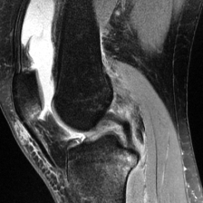
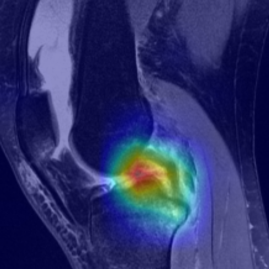
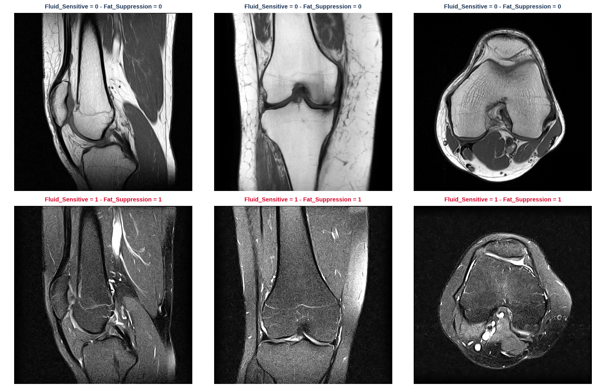
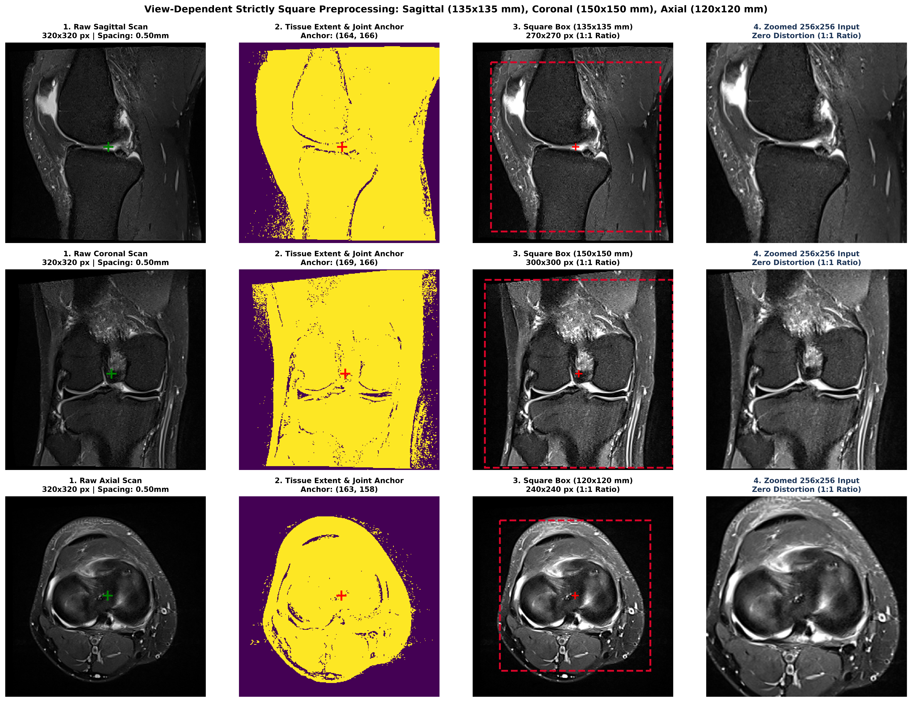
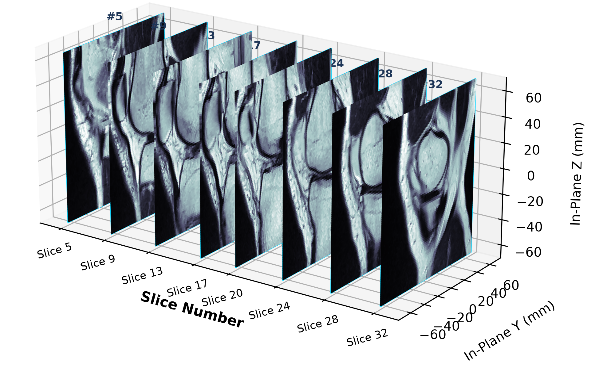
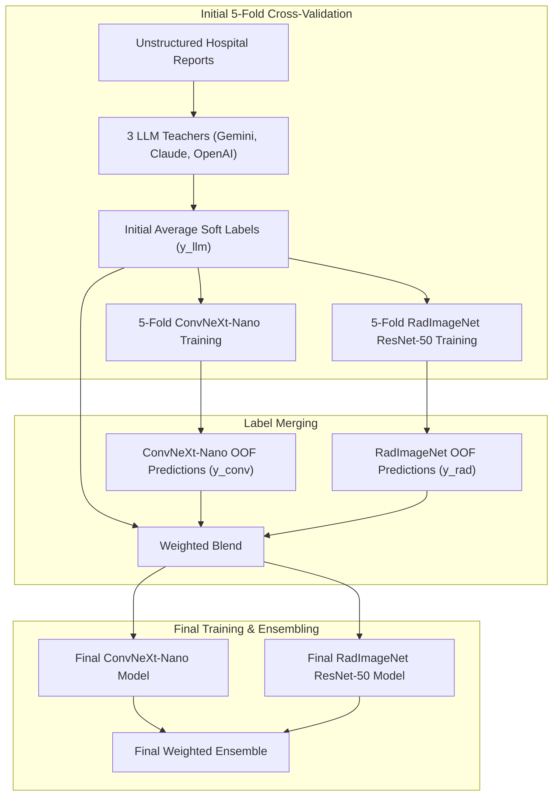
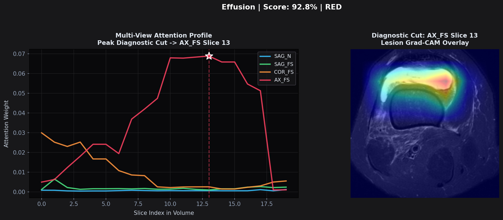

# RSNA Knee Abnormality Detection

  

  
  &nbsp;&nbsp;
  

## 1. Competition Description

The **[RSNA Knee Abnormality Detection Competition](https://www.kaggle.com/competitions/rsna-knee-abnormality-detection/overview)** tasks participants with predicting the presence of **12 structural knee abnormalities** from multi-sequence MRI examinations. Models must evaluate multi-plane volumetric DICOM series (Sagittal, Coronal, Axial) to identify ligament tears, meniscal lesions, compartment osteoarthritis, and joint fluid collections.

For full competition description, see the **[Official Kaggle Overview](https://www.kaggle.com/competitions/rsna-knee-abnormality-detection/overview)**.

### Evaluation Metric
Submissions are evaluated on **Macro-Averaged ROC-AUC** across the 12 target findings:

$$\text{Macro ROC-AUC} = \frac{1}{12} \sum_{c=1}^{12} \text{ROC-AUC}_c$$

Each class is weighted equally, rewarding balanced multi-label calibration across common and rare findings alike.

## 2. Dataset Description

The dataset comprises multi-sequence knee MRI examinations collected across international clinical sites with heterogeneous scanner hardware and imaging protocols.

### 2.1 Imaging Data (DICOM Hierarchy & Geometry)

Each patient examination represents a volumetric imaging session containing multiple sequence series:

* **Dataset Scale**: **4,407** training studies (`train.csv`) comprising **24,371** series (`train_series.csv`), averaging **5.53 series per study**.
* **Volumetric Slice Depth**: Median **30 slices** per series (IQR: 25–33 slices).
* **Viewing Planes**: **Sagittal** (40.5%), **Coronal** (35.3%), and **Axial** (24.2%).

<em>Six different planes views considered. </em>

### 2.2 Labels

The challenge requires predicting twelve binary labels (0/1):

* **ACL** – anterior cruciate ligament injury
* **MCL** – medial collateral ligament injury
* **Medial Meniscus** – medial meniscus tear
* **Lateral Meniscus** – lateral meniscus tear
* **Medial OA** – osteoarthritis of the medial tibiofemoral compartment
* **Lateral OA** – osteoarthritis of the lateral tibiofemoral compartment
* **PF OA** – patellofemoral osteoarthritis
* **Effusion** – joint effusion / excess fluid
* **Synovitis** – inflammation of the joint lining
* **Baker's** – Baker's cyst
* **Contusion** – bone contusion / bone bruise
* **Fracture** – fracture

For detailed target descriptions and DICOM metadata schemas, see the **[Official Kaggle Data Overview](https://www.kaggle.com/competitions/rsna-knee-abnormality-detection/data)**.

In particular:
* **Training Set**: Paired with raw, unstructured hospital radiology text reports.  Only a reference set of **58 studies ("Gold 58")** is annotated.
* **Test Set**: **Image-only**.

## 3. Standard Preprocessing

Knee MRI examinations vary substantially in Field of View, slice count (11 to 320 slices), table direction, and laterality. Raw DICOMs are standardized:

### 3.1 6 Canonical Series Slots
Every patient's multi-sequence examination is mapped into **6 standardized anatomical views**:
* `SAG_N`, `SAG_FS` (Sagittal Non-FS / Fat-Suppressed)
* `COR_N`, `COR_FS` (Coronal Non-FS / Fat-Suppressed)
* `AX_N`, `AX_FS` (Axial Non-FS / Fat-Suppressed)

* **Duplicate Resolution**: If multiple series match the same slot, the acquisition with the **highest slice count** is selected.
* **Missing Slot Handling**: Missing sequences are zero-filled and tracked via a boolean `present_mask (6,)`, allowing the neural network to identify which sequences are physically available.

### 3.2 Dynamic Contrast Normalization
A **dynamic 1st–99th percentile intensity windowing** is applied over voxels, suppressing surface-coil hyperintensity spikes and normalizing soft-tissue contrast to $[0, 1]$.

### 3.3 Automated Joint Centering & Crops
Raw MRI scans contain empty air background. Resizing the full image down to model input resolution shrinks fine structures into tiny, unresolvable pixels.

1. **Automated Tissue Centering**:
   An adaptive threshold separates true biological tissue from scanner air noise. The **2D center of mass** of the tissue mask is calculated, centering the crop box on the knee joint.
2. **View-Dependent Physical Millimeter Crops**:
   To preserve physical anatomical scale across variable scanner FOVs, fixed physical millimeter windows are extracted:
   * **Sagittal ($135 \times 135\text{ mm}$)**
   * **Coronal ($150 \times 150\text{ mm}$)**
   * **Axial ($120 \times 120\text{ mm}$)**
3. **Standard Crop**:
   Every image is then rezised to $224 \times 224$.

<em>3 view preprocessing steps.</em>

### 3.4 Laterality Normalization (Left Knee Canonical Frame)
To present the models with a consistent anatomical layout, right knees are mirrored to match a standard left-knee coordinate frame.

<em>3D Volumetric MRI Recontruction: different slices along the X-Axis, Sagittal View.</em>

## 4. Models Used

The solution couples two fast, complementary architectures:

### 4.1 ConvNeXt-Nano 6-View Gated Attention MIL

* **Backbone**: `convnext_nano` ($7\times7$ depthwise convolutions).
* **Sampling (112 Slices)**: Uniform depth sampling across 6 sequences (40 Sagittal, 40 Coronal, 32 Axial) captures the full 3D joint efficiently.
* **2.5D Tri-Slice Stacking**: Groups adjacent slices $(z-1, z, z+1)$ into 3-channel inputs, adding 3D spatial continuity without heavy volumetric memory overhead.
* **Learnable View Embeddings**: A shared backbone processes all slots, conditioned by sequence-specific embeddings.
* **Gated Attention MIL Pooling**: Dynamically prioritizes slices showing pathology while downweighting normal anatomy.

### 4.2 RadImageNet ResNet-50 Medical Transfer Learning

* **Pretrained Medical Foundation**: Pretrained on RadImageNet (1.35M radiologist-annotated scans).
* **Sampling (32 Slices)**: 16 Sagittal, 8 Coronal, and 8 Axial slices.
* **Pure 2D Slice Feature Extraction**: Evaluates independent slices expanded to 3 channels to match pretraining, extracting 2048-dim radiological tokens.
* **FoundationQueryHead**: Projects tokens to 512 dimensions, injects viewing plane and depth encodings, and fuses sequences using multi-sequence attention (0.3 dropout)

## 5. Labels: The 3 LLM Report Teachers

While the test set requires diagnosing directly from pixel volumes without text reports, the training set pairs each examination with an unstructured report, written in free natural language by radiologists across multiple languages with varying shorthand and diagnostic ambiguity.

To extract reliable supervisory signals from text, labels were generated using **three frontier Large Language Models (LLMs)** evaluated strictly on the report:

1. **Claude-Opus-5** (via community extractions by `pilkwang`) https://www.kaggle.com/datasets/pilkwang/rsna-knee-llm-labels
2. **Gemini-2.5-flash** (via community extractions by `stevenleehans`) https://www.kaggle.com/datasets/stevenleehans/rsna-knee-llm-report-labels
3. **GPT-5.6-Sol** (via community extractions by `lixin73`)
https://www.kaggle.com/datasets/lixin73/rsna-knee-llm-report-labels-sol56

### LLM Label Set Building
Predictions across the 3 LLM teachers were averaged into a single representation:

$$y_{\text{LLM}} = \frac{1}{3} \left(y_{\text{Gemini}} + y_{\text{Claude}} + y_{\text{Gpt}}\right)$$

* **Mitigating Prompt Biases**: Where one model was overly conservative on mild findings or misinterpreted shorthand, consensus averaging canceled out single-model extraction errors.
* **Continuous Soft Targets**: averaging yields continuous supervisory probabilities $y \in [0, 1]$ rather than hard binary cutoffs, preserving diagnostic uncertainty.

### Validation Against Expert Gold 58 Labels
Macro ROC-AUC evaluation of the individual LLM extractions and their average against the 58 expert-verified image ground truth set:

| Model | Gold 58 Macro ROC-AUC |
| :--- | :---: |
| **Google Gemini** | 0.866 |
| **Anthropic Claude** | 0.878 |
| **OpenAI GPT** | 0.835 |
| **3-LLM Ensemble** | 0.883 |

## 6. Methodology

The training methodology follows a two-stage label refinement loop combining multi-sequence vision architectures with explainability mechanisms:

> **Training Configurations**: Complete hyperparameters (learning rates, batch sizes, optimizer schedules, and loss weightings) can be inspected in [`configs/convnext.yaml`](configs/convnext.yaml) and [`configs/radimagenet.yaml`](configs/radimagenet.yaml).

### 6.1 Initial 5-Fold Cross-Validation
* **Stratified 5-Fold Split**: The 4,407 training examinations were partitioned into 5 balanced folds.
* **Initial Supervision**: Models were trained on the initial 3-LLM soft labels ($y_{\text{LLM}}$).
* **OOF Prediction Extraction**: Full out-of-fold probability predictions were extracted across all 4,349 non-gold training examinations, and validation was benchmarked against the 58 Gold cases.

### 6.2 OOF Label Merging & Self-Distillation
Computer vision models evaluate the raw pixels directly and identify pathology missed in the dictated text. For this reason, the 3 sources were merged:
1. **ConvNeXt 5-Fold OOF Predictions** ($y_{\text{conv}}$)
2. **RadImageNet Feature Predictions** ($y_{\text{rad}}$)
3. **3-LLM Report Consensus** ($y_{\text{llm}}$)

$$y_{\text{distilled}} = w_{\text{conv}} \cdot y_{\text{conv}} + w_{\text{rad}} \cdot y_{\text{rad}} + w_{\text{llm}} \cdot y_{\text{llm}}$$

The distillation weights were optimized to maximize Macro ROC-AUC against the 58 expert Gold standard cases. This self-distillation step cleaned up report noise and filled in under-reported findings, creating a refined training label set.

### 6.3 Final Training & Ensembling
* **Final Model Training**: Models were retrained on the refined continuous distilled targets.
* **Ensembling**: Test-time predictions from both backbones were blended using linear weights:

$$\hat{P}_f = w_{\text{conv}} \cdot P_{\text{ConvNeXt}, f} + w_{\text{rad}} \cdot P_{\text{RadImageNet}, f}$$

### 6.4 Explainable AI Methods
To ensure clinical plausibility, two interpretability mechanisms were integrated directly into the architectures:

1. **Slice-Level Gated Attention Weights**:
   The Gated Attention pooling module outputs an attention score $a_k \in [0, 1]$ for each slice along volume depth.
   Plotting $a_k$ across volume depth reveals which anatomical slice triggered the diagnosis.

2. **Spatial Grad-CAM**:
   Gradient-weighted class activation maps computed on the final convolutional layer localizing specific structural defects.

## 7. Results

### 7.1 Model & Ensemble Evaluation Overview

Validation and competition scores across the individual models, 5-fold iterations, and final ensembling:

| Model / Pipeline Configuration | Local OOF Macro-AUC | Gold 58 Macro-AUC | Kaggle Public LB | Kaggle Private LB |
| :--- | :---: | :---: | :---: | :---: |
| **5-Fold RadImageNet ResNet-50** | 0.843 | 0.861 | 0.890 | 0.870 |
| **5-Fold ConvNeXt-Nano 6-View** | 0.901 | 0.906 | 0.926 | 0.912 |
| **1-Fold RadImageNet ResNet-50** | N/A | 0.880 | 0.899 | 0.874 |
| **1-Fold ConvNeXt-Nano 6-View** | N/A | 0.908 | 0.924 | 0.905 |
| **Final Ensemble** | N/A | 0.911 | 0.927 | 0.906 |

### 7.2 Optimal Distillation Label Weights
Blending vision out-of-fold (OOF) predictions with the 3-LLM report consensus produced refined supervisory targets, raising Gold 58 Macro ROC-AUC from **0.883** to **0.928** (+0.045 gain):

| Supervisory Source | Component | Distillation Weight ($w$) |
| :--- | :--- | :---: |
| **ConvNeXt-Nano 5-Fold OOF** ($y_{\text{conv}}$) | Multi-plane 2.5D vision predictions | **0.45** |
| **RadImageNet ResNet-50** ($y_{\text{rad}}$) | Radiological foundation predictions | **0.30** |
| **3-LLM Teacher Consensus** ($y_{\text{llm}}$) | Report text extraction consensus | **0.25** |

### 7.3 Optimal Test Ensemble Weights
The final test-time predictions combine both vision architectures using a 70/30 linear blend:

| Architecture| Ensemble Weight ($w$) |
| :--- | :---: |
| **ConvNeXt-Nano** |  **0.70** |
| **RadImageNet ResNet-50** |  **0.30** |

### 7.4 xAI interpretation

The Explainable AI (xAI) module provides transparent visual evidence for model predictions. Use the Multi-View Attention Curves to pinpoint exactly which depth slices triggered a positive diagnosis, and the Grad-CAM Lesion Heatmap to localize the specific structural defect (e.g., a ligament tear) within that slice. This dual approach allows clinicians to rapidly verify the model's diagnostic reasoning and trust its outputs.

<em>Explainable AI. On the left Multi-View Attention Curves, on the right Diagnostic Cut with Grad-CAM Lesion Heatmap.</em>

## 8. Notes

* Built for computational efficiency and modularity. While larger models would boost scores, this framework completes training and validation in hours with a minimal GPU footprint, while still achieving good results.
* **Competition Result**: This architecture was blended with top public competition solutions, achieving a **Kaggle Bronze Medal**.

### Future Improvements

1. **Backbone Scaling & Higher Input Resolutions**:
   Upgrade to larger feature extractors and higher input resolutions ($384\times384$) to resolve finer details.
2. **Multi-Seed Averaging & 10-Fold Ensembles**:
   Train 10-fold ensembles across multiple seeds to stabilize predictions on rare findings.
3. **Vision-Language Pretraining**:
   Pretrain backbones directly on paired scans and text reports.

## 9. Quickstart Notebook

A Jupyter Notebook walking through a patient examination, visualizing the 6-view physical millimeter crops, executing dual-model inference, and rendering inline two-tier xAI cards is available in **[`Kaggle`](https://www.kaggle.com/code/mtonello/rsna-knee-abnormality-detection-demo)**.

### Note on Kaggle Competition Execution
This repository houses the clean, modular engineering architecture developed for local development and verification. For execution inside the competition environment, the modular components were packaged into self-contained Kaggle submission kernels pulling precomputed weights directly from Kaggle Datasets.

## 10. Credits & References

### Acknowledgments
* **Radiological Society of North America (RSNA)** for organizing the challenge and sharing the dataset.
* **Community Contributors**: Thanks to Kaggle users **`pilkwang`**, **`stevenleehans`**, and **`lixin73`** for generating and open-sourcing the Large Language Model report extractions.

### References
* **Attention-based Deep Multiple Instance Learning** (Gated Attention MIL): 
  Ilse, M., Tomczak, J., & Welling, M. (2018). *International Conference on Machine Learning (ICML)*.
* **RadImageNet**: 
  Mei, X., et al. (2022). RadImageNet: An Open Radiologic Deep Learning Research Dataset for Effective Transfer Learning. *Radiology: Artificial Intelligence*.
* **ConvNeXt**: 
  Liu, Z., et al. (2022). A ConvNet for the 2020s. *Proceedings of the IEEE/CVF Conference on Computer Vision and Pattern Recognition (CVPR)*.
* **Grad-CAM**: 
  Selvaraju, R. R., et al. (2017). Grad-CAM: Visual Explanations from Deep Networks via Gradient-based Localization. *International Conference on Computer Vision (ICCV)*.
